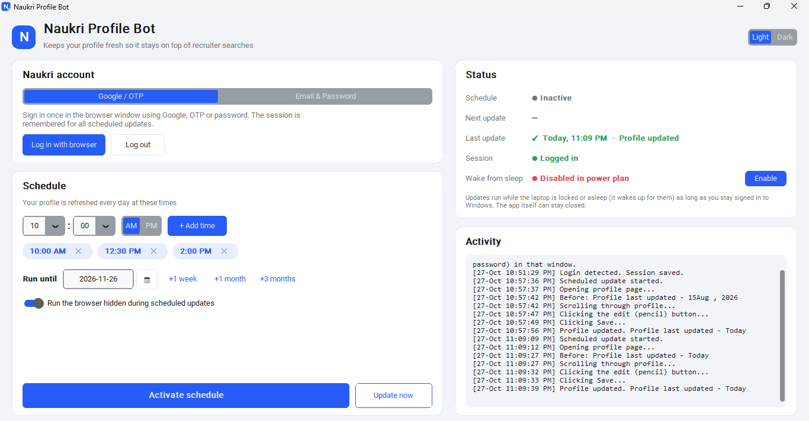

# Naukri Profile Bot

**Keep your Naukri profile at the top of recruiter searches, automatically.**

Naukri ranks recently updated profiles higher. This Windows app refreshes your profile at the times
you choose, every day: it opens your profile, clicks the edit (✏️) button and clicks **Save**,
without changing any of your details. Recruiters see "Profile last updated: Today".



## Features

- **Daily schedule.** Pick any times (e.g. 10:00 AM, 12:30 PM, 2:00 PM) and an end date.
- **Runs in the background.** The app can be closed, and updates still run when the laptop is
  **locked** or **asleep**: Windows wakes it up for each update.
- **Google, OTP or password login.** Log in once and the session is remembered. Passwords are
  stored in Windows Credential Manager, never in a plain file.
- **Re-login prompt.** If your Naukri session expires, a browser window opens and asks you to
  log in again, then the update continues.
- **Retries and catch-up.** Waits for Wi-Fi after waking, retries on failure, and runs a missed
  update as soon as the laptop is back on.

## Installation

**Requirements:** Windows 10 or 11 (64-bit) with Microsoft Edge, which comes with Windows.
No Python or other software is needed.

1. Download **`NaukriProfileBot-Setup-x.y.z.exe`** from the
   [latest release](https://github.com/Acronikhil/Naukri_bot/releases/latest).
2. Run it. If Windows shows **"Windows protected your PC"**, click **More info → Run anyway**.
   This appears because the installer isn't code-signed.
3. Follow the wizard. No administrator rights are needed.

## Setup (one time, about 2 minutes)

| Step | Where | What to do |
|---|---|---|
| **1. Log in** | *Naukri account* | Click **Log in with browser** and sign in to Naukri (Google, OTP or password). The browser closes on its own when you're logged in. *Or* choose **Email & Password**, enter your details and click **Save credentials**. |
| **2. Choose times** | *Schedule* | Pick a time, click **+ Add time**, and repeat for each time you want. Set **Run until** (use the 📅 button or **+1 week / +1 month / +3 months**). |
| **3. Allow wake from sleep** | *Status* | If **Wake from sleep** says *Disabled*, click **Enable**. |
| **4. Activate** | *Schedule* | Click **Activate schedule**. Use **Update now** to test it right away. |

You can now close the app. **Status** shows the next and last update whenever you open it again.

## Good to know

- **Stay signed in to Windows.** Updates run while the laptop is locked or asleep, but not
  after you sign out or shut down. A missed update runs the next time the laptop is on.
- **Lid closed:** if the laptop is asleep in a bag at an update time, it wakes for about a minute.
- **Hidden browser:** by default updates run in an off-screen browser. Turn off
  *Run the browser hidden* to watch it work.
- **Changing the schedule:** edit times or the end date at any time; an active schedule updates itself.

## Troubleshooting

| Problem | Fix |
|---|---|
| Status shows **Not logged in** | Click **Log in with browser** and sign in again. |
| Updates don't run while asleep | Check that **Wake from sleep** says *Enabled*. If **Enable** fails, turn it on manually: *Control Panel → Power Options → Change plan settings → Change advanced power settings → Sleep → Allow wake timers → Enable*. |
| An update failed | Read the **Activity** log. A screenshot of the failure is saved to `%APPDATA%\NaukriProfileBot\last_error.png`. |
| Naukri changed its website and the edit/Save button isn't found | Add a working CSS selector as `custom_edit_selector` / `custom_save_selector` in `%APPDATA%\NaukriProfileBot\config.json`, or [open an issue](https://github.com/Acronikhil/Naukri_bot/issues). |

## Uninstall

*Settings → Apps → Installed apps → Naukri Profile Bot → Uninstall.* This also removes the
scheduled task, and asks whether to delete your settings and saved login.

## Privacy

Everything stays on your computer. Your password is in Windows Credential Manager, and your
browser session, settings and logs are in `%APPDATA%\NaukriProfileBot`. The app talks only to
naukri.com.

---

## For developers

**Run from source** (Python 3.11+):

```powershell
pip install -r requirements.txt
python main.py
```

**Build the installer** (needs [Inno Setup 6](https://jrsoftware.org/isinfo.php):
`winget install JRSoftware.InnoSetup`):

```powershell
.\build.ps1        # -> dist\NaukriProfileBot-Setup-<version>.exe
```

**Publish a release:** bump `APP_VERSION` in `config.py`, commit, then push a matching tag.
GitHub Actions builds the installer and attaches it to a new release.

```powershell
git tag v1.0.0
git push origin v1.0.0
```

| File | Purpose |
|---|---|
| `main.py` | Entry point: UI, `--run-task` (scheduled update), `--uninstall` |
| `app.py` | Desktop UI (CustomTkinter) |
| `bot.py` | Browser automation with Playwright and Microsoft Edge |
| `run_task.py` | One scheduled update: network wait, retries, re-login prompt |
| `task_scheduler.py` | Windows Task Scheduler task and wake timers |
| `config.py` | Settings, status, log and credential storage |
| `installer/` | Inno Setup script and post-install instructions |
